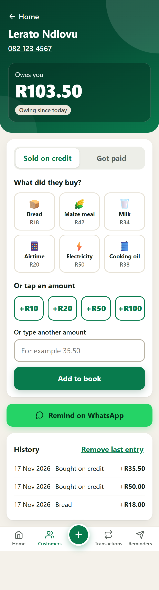
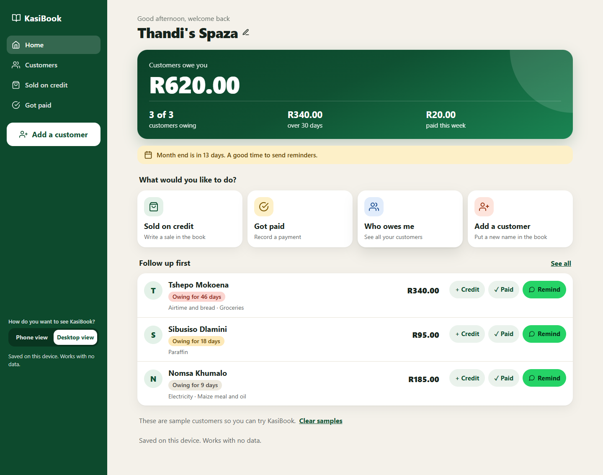
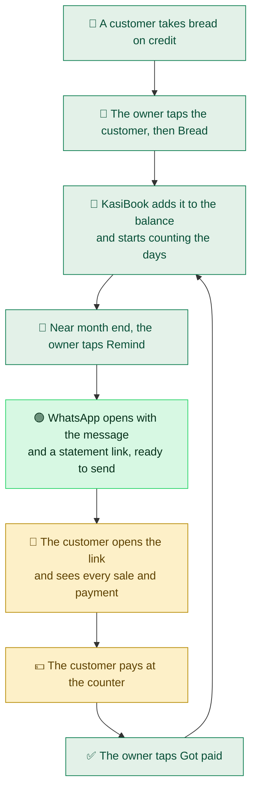
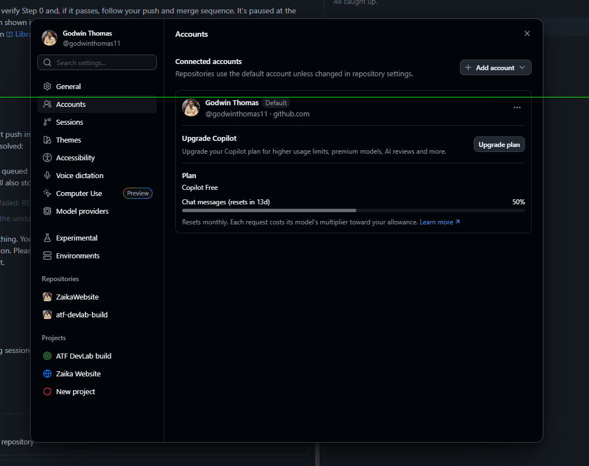

<div align="center">


# KasiBook

### The spaza shop credit book, on the owner's phone.

**Record credit in two taps. See who owes what. Remind them on WhatsApp.**<br>
**Works with no internet. No sign-up. No fees. The book never leaves the phone.**


<br>


## 👉 [Open the live app](https://godwinthomas11.github.io/atf-devlab-build/) 👈

</div>

---

## 📌 At a Glance

| | |
|---|---|
| 👤 **Who** | **Godwin Thomas**, an international student studying Artificial Intelligence and Data Science at MIT-WPU, Pune, India. **A team of one.** |
| 🏆 **Where** | **Cape Code Hackathon**, Africa Tech Festival, Cape Town, 17 November 2026 |
| 🧩 **The problem** | South Africa's spaza shops lend to their neighbours every day, and the only record is a **paper notebook** that gets lost, disputed and never shared with the customer. |
| 💡 **The solution** | A credit book on the owner's phone: **two taps** to record, **automatic** balances and ageing, and **WhatsApp reminders** that carry the customer's own statement. |
| 🌍 **Why it matters** | It protects the cash of the smallest businesses on the continent, builds trust between shop and customer, and runs on any phone, **with no data, no account and no cost**. |

> [!IMPORTANT]
> **I competed alone, as a team of one.** I worked on a **free GitHub Copilot account**, with no paid plan and no teammates. See [Tokens and Tools](#-tokens-and-tools).

---

## 📸 Screenshots

<table>
<tr>
<td align="center" valign="top"><br><b>1. Welcome</b><br><sub>Name your shop, start in one tap</sub></td>
<td align="center" valign="top"><br><b>2. Home</b><br><sub>Who owes what, at a glance</sub></td>
<td align="center" valign="top"><br><b>3. Record in two taps</b><br><sub>Tap an item or an amount</sub></td>
<td align="center" valign="top"><br><b>4. What the customer sees</b><br><sub>Their own statement, from WhatsApp</sub></td>
</tr>
</table>

<details>
<summary><b>🖥️ See the desktop view</b> (for a laptop or office computer)</summary>
<br>

</details>

---

## 🧩 The Problem

> [!NOTE]
> **The scale.** About **150,000 spaza shops** serve about **11 million regular shoppers** in South Africa ([Trade Intelligence, reported by Daily Investor](https://dailyinvestor.com/retail/26514/south-african-spaza-shop-market-bigger-than-shoprite/)), in a market estimated at **R197 billion in 2023** ([Daily Investor](https://dailyinvestor.com/retail/61472/south-africas-r197-billion-hidden-retail-economy/)).

A spaza is a small shop run from a home in a township. It sells the things a household runs out of: bread, maize meal, paraffin, airtime, electricity. A large share of that trade happens **"on the book"**: the customer takes the goods now and pays later.

### 💳 Credit Is How Households Reach Month End

Many households are paid once a month, through a salary or a grant, but they need groceries every day. In between, **the spaza owner quietly becomes the neighbourhood's lender.** There is no contract and no credit check. It runs on trust and on one notebook.

### 📓 One Notebook Holds the Whole Loan Book

The money customers owe is the shop's **working capital**: the cash that should buy tomorrow's stock. All of it is recorded in a single paper notebook. One spill, one torn page or one break-in, and **the record of who owes what is gone, and the money goes with it.** Totals are added up by hand at a busy counter, so mistakes creep in.

### ⚖️ Only One Side Holds the Record

The customer never sees the book. When the shop asks for R340, the customer remembers R250. **Neither side can prove anything**, so the shop either loses the money or loses a regular customer. In a business that lives on repeat visits from neighbours, both hurt.

### 😶 Asking for Money Is Socially Expensive

The customers are neighbours, relatives and regulars. Chasing a debt face to face is awkward, so reminders come late or not at all, and **money that is owed is quietly written off.**

### 🫥 A Good Track Record Stays Invisible

A shop that lends and gets repaid month after month has a real business history. In a notebook, **nobody else can see it**, so it cannot support a request for stock on credit or help the shop grow.

### 📵 Why an Ordinary App Does Not Fit This Counter

A tool for a spaza counter has to meet hard constraints:

- **No data guaranteed.** Mobile data costs money and the signal comes and goes.
- **No time.** Recording a sale must be faster than writing it in the book.
- **No sign-up.** No forms, no passwords, no email address.
- **No handing over the book.** The owner's customer list is private business information.
- **Any phone.** It has to run on the phone the owner already has.

**KasiBook was designed around these five constraints, not around a feature list.**

---

## 💡 How KasiBook Solves It

| The problem | What KasiBook does |
|---|---|
| 📓 The notebook gets lost or damaged | The book lives on the phone. A **backup file** brings it back on a new phone. |
| ➕ Totals are added by hand | Every balance adds up **automatically, to the cent**. |
| ⚖️ Only the shop holds the record | Every reminder carries **the customer's own statement**, so both sides see the same book. |
| 😶 Asking is awkward | One tap writes a **polite, factual WhatsApp message**. The numbers do the talking. |
| ⏱️ The counter is busy | **Two taps**: the customer, then the item. |
| 📵 No data, no money for apps | Works **offline**, **free**, with **no sign-up**. |
| 📒 Old debts are in the paper book | A new customer can start with **what they already owe, and since when**. |

---

## 🌍 Why This Matters for Africa

- 💰 **It protects the cash of the smallest businesses.** Every rand that is recorded and reminded about is a rand that is less likely to be forgotten.
- 🤝 **It builds trust.** When the shop and the customer see the same record, there is nothing to argue about, and the relationship survives the debt.
- 🙏 **It keeps dignity on both sides.** A clear statement replaces an awkward conversation at the counter.
- 📱 **It includes people other apps leave out.** No bank account, no data bundle, no email, no fee and no new phone are needed.
- 📈 **It is a first step out of invisibility.** A digital record is the start of a trading history that a shop could one day show a wholesaler.
- 🧭 **It travels.** The same "on the book" credit runs in corner shops, kiosks and dukas across the continent. Nothing in KasiBook depends on a server, so moving it to another country mainly means changing the currency, the phone number format and the language.

---

## ✨ Features

### ⚡ Record in Two Taps
- **Six one-tap items:** Bread, Maize meal, Milk, Airtime, Electricity and Cooking oil, at **the shop's own prices** (set them with **Change prices**).
- **Quick amounts:** `+R10`, `+R20`, `+R50` and `+R100`, or type any amount.
- **Payments the same way**, plus **Paid in full**. KasiBook will not let you record more than the customer owes.
- **Undo after every entry**, and **Remove last entry** for older mistakes.

### 👥 Know Who Owes What
- **Home dashboard:** total owed, how many customers owe, how much is **over 30 days** and how much was **paid back this week**.
- **Ageing labels** such as "Owing for 46 days" turn **amber after two weeks** and **red after a month**. Payments settle the oldest sales first, the way a shopkeeper thinks.
- **Follow up first:** the customers who have owed the longest.
- **Customers list** with search and filters (**All**, **Over 30 days**, **Bought this month**). Every customer has **Credit**, **Paid** and **Remind** buttons.
- **Transactions:** every sale and payment, newest first, with **today's totals**.
- **Month-end banner:** "Month end is in 13 days. A good time to send reminders."

### 💬 Remind on WhatsApp
- **One tap** opens WhatsApp with a polite message already written, including the balance and a **link to the customer's own statement**.
- Local numbers such as `082 123 4567` are converted automatically to the format WhatsApp needs.
- **Reminders page:** everyone who owes, each with a Remind button.

### 📒 Move Over From the Paper Book
- When adding a customer, type **what they already owe** and **since which day**. KasiBook ages the debt correctly from that date.
- **Sample customers** show how everything works. **Clear samples** removes them in one tap.

### 🛡️ Keep the Book Safe
- **Download backup** saves the whole book as a file. **Load backup** restores it, even from the welcome screen of a new phone.
- Every backup file is **checked before it is loaded**, and loading it can be **undone**.

### 📱 Phone and Desktop
- **Phone view:** big buttons and a bottom bar within reach of a thumb.
- **Desktop view** (on a laptop or office computer): a sidebar and a customer table. Switch views at any time.
- **Add to Home screen** and KasiBook opens like any other app.

---

## 🔄 How It Works, End to End



### 1️⃣ Start the Book
Open the link, type the shop's name and tap **Start my book**. There is no account and no password. The book is created on the phone.

### 2️⃣ Add a Customer
Type a name. A WhatsApp number is optional. If the customer already owes money in the paper book, type the amount and the day it started.

### 3️⃣ Record a Sale
Tap **Sold on credit**, tap the customer, then tap **Bread** (or an amount). The balance updates at once, and an **Undo** button appears in case of a wrong tap.

### 4️⃣ Watch the Debt Age
Each customer shows how long they have owed. The home screen puts **the oldest debts first**, so the owner knows whom to follow up.

### 5️⃣ Send the Reminder
The owner taps **Remind**. WhatsApp opens with this message already written:

```text
Hi Tshepo, a friendly reminder from Thandi's Spaza: your balance is R340.00.

See your statement:
https://godwinthomas11.github.io/atf-devlab-build/#s=eyJzIjoiVGhhbmRp…

Thank you!
```

- **If the customer's number is saved,** the chat with that customer opens directly. The owner only presses **Send**.
- **If no number is saved,** WhatsApp asks which chat to send it to, so the owner can pick the customer or a family member.

### 6️⃣ The Customer Opens Their Statement
The link opens in any browser, with **no app and no sign-up**. The customer sees the shop's name, their balance and their latest entries. The statement is **packed inside the link itself**, so it still works when it is **forwarded**, for example to the family member who pays the bills.

### 7️⃣ Payment Closes the Loop
The customer pays at the counter. The owner taps **Got paid**, then an amount or **Paid in full**. The balance drops, and the next reminder carries the updated statement. When the customer is paid up, the button becomes **Send statement**, with a thank-you message instead of a reminder.

---

## 📴 Works Offline, by Design

- **The first visit saves a copy of the app on the phone** (using a service worker, a small helper script that the browser keeps).
- **After that, KasiBook opens with no internet**, even in flight mode.
- **When there is internet, it fetches the newest version first**, so updates arrive by themselves.
- **Only sending a WhatsApp message needs data.** Recording, checking balances and searching never do.

> [!TIP]
> On Android, open the browser menu and choose **Add to Home screen**. On iPhone, tap the **Share** button, then **Add to Home Screen**. KasiBook then opens from its own icon, like any other app.

---

## 🔒 Your Data Stays on Your Phone

| What | Where it lives | Who can see it |
|---|---|---|
| 📒 Customers, sales and payments | **On the owner's phone only**, in the browser's own storage | **Only the owner** |
| 📄 A customer's statement | **Inside the WhatsApp link**, after the `#`. Browsers never send that part to any server. | Whoever has the link |
| 💾 A backup | A file the owner downloads | Wherever the owner keeps it |
| 🌐 The app itself | Served by GitHub Pages, then saved on the phone | Public, but it holds no data |

- **No server, no database, no account and no tracking.** There is nowhere for the book to leak from.
- **No AI at runtime.** Balances, ageing and reminders are plain rules: instant, free and the same every time.
- **Statement links are kept small on purpose.** They hold only the shop's name, the customer's name, the balance and the last 12 entries.
- **Everything from outside is checked.** Statement links and backup files can be edited by anyone, so every field is checked and capped before it is shown or loaded. Names are always shown as text, so they can never break the page.

---

## 🚀 Try It

### 🏪 For Shop Owners (No Technical Skills Needed)
1. Open the **[live app](https://godwinthomas11.github.io/atf-devlab-build/)** on your phone.
2. Type your shop's name and tap **Start my book with sample customers**.
3. Play with the three sample customers, then tap **Clear samples**.
4. Tap **Add a customer** and start your own book.

### 💻 For Developers and Judges
- **No install and no build.** Download this repository and open `index.html` in a browser.
- **Offline mode** needs `localhost` or HTTPS. From this folder, run `python -m http.server 4173` and open http://localhost:4173/.
- **Self-check:** open `index.html?test` and read the browser console. It checks the money, phone number, ageing, statement, date and backup rules.

---

## 🛠️ How It Is Built

| File | Job |
|---|---|
| `index.html` | The whole app: page, styles and logic in plain HTML, CSS and JavaScript |
| `sw.js` | The service worker: keeps a copy on the phone so the app opens offline |
| `manifest.json`, `icon.svg` | Let the app install to the home screen with its own icon |

- **Four small files, about 65 KB in total.** No framework, no packages and no build step.
- **Money is stored in whole cents**, so totals never drift by a cent.
- **WhatsApp with no API:** reminders use an ordinary `wa.me` link, so there is no business account and no cost per message.

---

## 🪙 Tokens and Tools

> [!NOTE]
> **One person, one free account.** I worked alone, on a **free GitHub Copilot account**: no paid plan and no teammates' accounts to share the work. The free plan's monthly allowance is small, so my usage shows up as a **larger percentage** of that allowance than the same work would on a paid plan.

### GitHub Copilot Usage



### How I Kept Tokens Low
1. **Plan first, build small.** The problem, features, screens and edge cases were written down before any code was requested. The design changed a few times during the build, but the finished app is four small files, about 65 KB in total.
2. **No framework, no packages, no build step.** Plain HTML, CSS and JavaScript leave nothing to scaffold, configure or debug.
3. **No AI inside the app.** Simple rules mean the app costs zero tokens to use and cannot stall during a demo.

---

## 🧭 Limits and What Comes Next

- **The book lives on one phone.** Backups are made by hand today. Automatic backup comes next.
- **Statement links can be read by anyone who has the link**, which is why they hold so little.
- **Next:** more languages (isiZulu, isiXhosa, Afrikaans), pay-day reminders, and using a shop's KasiBook history as **proof of trade** when asking wholesalers for stock on credit.

---

## 👋 About Me

I'm **Godwin Thomas**, an **international student** studying **Artificial Intelligence and Data Science at MIT-WPU, Pune, India**. I entered the Cape Code Hackathon **on my own, as a team of one**, and built KasiBook during the hackathon day.

I study AI, and the most useful decision I made here was **not** to put AI inside the app. A shop owner needs a book that opens instantly, costs nothing and never goes down. Simple, checkable rules do that better than a model.

<div align="center">

---

**Built by [Godwin Thomas](https://github.com/godwinthomas11) for the Cape Code Hackathon, Africa Tech Festival, Cape Town, 2026.**

⭐ *If KasiBook would help a shop you know, star this repository.*

</div>
