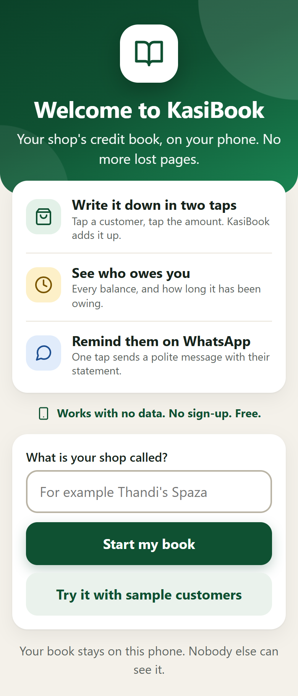
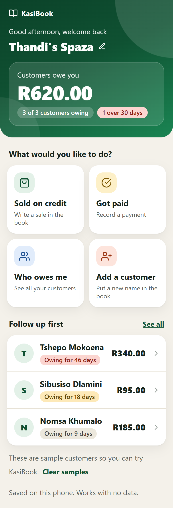
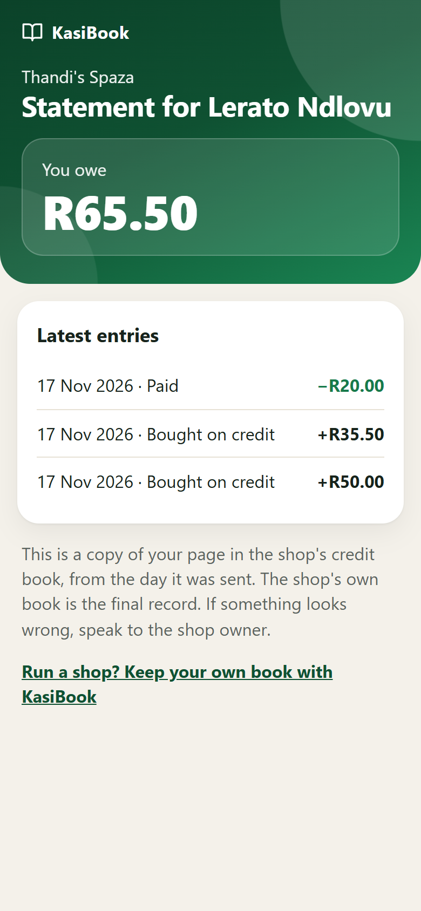

# KasiBook

**The spaza shop credit book, on the owner's phone.** See who owes what, and remind them on WhatsApp in one tap. Works with no internet, no sign-up and no fees.

**Live app:** https://godwinthomas11.github.io/atf-devlab-build/

Built at the Cape Code Hackathon, Africa Tech Festival, Cape Town, 17 November 2026.

| Welcome | Home | Record in two taps | What the customer sees |
|---|---|---|---|
|  |  |  |  |

## The African problem

Spaza shops sell bread, airtime and paraffin to neighbours who pay at month end. Every sale "on the book" goes into a paper notebook.

- The notebook gets wet, torn or lost, and the record goes with it.
- Totals are added up by hand, at a busy counter.
- Customers dispute what they owe, because only the shop holds the record.
- Asking for money is awkward, so much of it is never collected.

This is a large part of everyday trade. About 150,000 spaza shops serve about 11 million regular shoppers in South Africa ([Trade Intelligence, reported by Daily Investor](https://dailyinvestor.com/retail/26514/south-african-spaza-shop-market-bigger-than-shoprite/)), in a market estimated at R197 billion in 2023 ([Daily Investor](https://dailyinvestor.com/retail/61472/south-africas-r197-billion-hidden-retail-economy/)).

## What KasiBook does

The home screen greets the owner and asks one question: "What would you like to do?" Four big buttons answer it: **Sold on credit**, **Got paid**, **Who owes me**, **Add a customer**.

1. **Record in two taps.** Choose the customer, tap `+R10`, `+R20`, `+R50` or `+R100`. Or type any amount. Payments work the same way, and every entry can be undone.
2. **See who owes what.** The total owed is at the top, with a "Follow up first" list of who has owed the longest. Each customer has a label such as "Owing for 46 days" that turns amber after two weeks and red after a month.
3. **Remind on WhatsApp.** One button opens WhatsApp with a polite message already written, including the balance.
4. **The customer sees the same book.** The message carries a link to the customer's own statement: every sale, every payment, the balance. Both sides hold the same record, so there is nothing to argue about.

## For shop owners: you do not need to be technical

1. Open the link on your phone. Type your shop's name and tap **Start my book**.
2. Tap your browser's menu and choose **Add to Home screen**. KasiBook now opens like any other app, even with no data.
3. Tap **Add a customer** and type a name. A WhatsApp number is optional.
4. When they buy on credit, tap **Sold on credit**, tap their name and tap the amount. That is all.

Not sure yet? Tap **Try it with sample customers** on the welcome screen. Tap **Clear samples** when you are ready to start your own book.

## How it works

- **Offline.** The first visit saves a copy of the app on the phone (a service worker, `sw.js`). After that it opens with no internet. Only sending a WhatsApp message needs data.
- **Private.** The book is stored on the phone itself (`localStorage`). There is no server, no account and no database, so nobody else holds the shop's records.
- **Statements with no server.** A customer's statement is packed into the link itself. Opening the link unpacks it on the customer's phone.
- **WhatsApp with no API.** Reminders use an ordinary `wa.me` link. Local numbers such as `082 123 4567` are converted to the international format WhatsApp needs.
- **Money is exact.** Amounts are stored as whole cents, so totals never drift.

| File | Job |
|---|---|
| `index.html` | The whole app: page, styles and logic in plain HTML, CSS and JavaScript |
| `sw.js` | Keeps a copy on the phone so it opens offline |
| `manifest.json`, `icon.svg` | Lets it install to the home screen |

## How to run it

- **Easiest:** open the [live app](https://godwinthomas11.github.io/atf-devlab-build/).
- **On your computer:** download this repository and open `index.html` in a browser. There is nothing to install and nothing to build.
- **Self-check:** open `index.html?test` and look at the browser console. It checks the money, phone number, ageing and statement rules.

## How we kept tokens low

1. **Plan first, prompt once.** The problem, features, screens and edge cases were written down before any code was requested, so the app was generated in one pass with no rewrites.
2. **No framework, no packages, no build step.** Four small files in plain HTML, CSS and JavaScript. Nothing to scaffold, configure or debug.
3. **No AI at runtime.** Balances, ageing and reminders are simple rules, so the app costs zero tokens to use and cannot stall in a demo.

## Limits and what is next

- The book lives on one phone. A backup and a move-to-new-phone option come next.
- Statement links can be read by anyone who has the link, so they hold only the customer's name, the shop's name and the last 12 entries.
- Next: more languages, pay-day reminders, and using a shop's KasiBook history as proof of trade when asking wholesalers for stock on credit.

## Who built it

**Godwin Thomas**, a solo builder. I am an international student studying Artificial Intelligence and Data Science at MIT-WPU, Pune. I built KasiBook alone in the three hours of the hackathon.

I study AI, and the most useful decision here was to not use it inside the app. A shop owner needs a book that opens instantly, costs nothing and never goes down. Simple rules do that better than a model.
